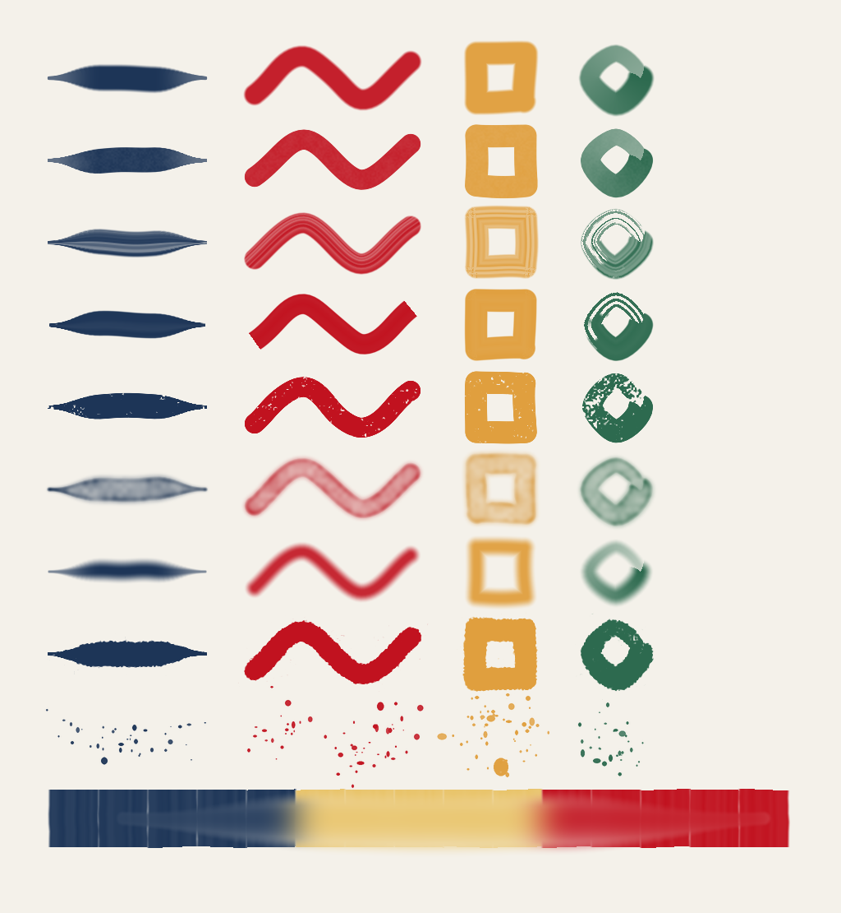

# painterly

A blank canvas for an AI agent. The model gets a set of brushes as tools and sees the
canvas after every mark it makes. It isn't given a subject, a style or a goal, and it
decides for itself when the work is finished. The question is what it makes when the
choice is entirely its own.



## Quick start

```bash
pip install -e .            # or: pip install -r requirements.txt
export ANTHROPIC_API_KEY=... # or `ant auth login`

python -m painterly run                     # one session, 150 actions max
python -m painterly run --runs 5 --seed 10  # five independent sessions
python -m painterly sampler -o brushes.png  # brush reference sheet, no API calls
python -m painterly replay runs/<id>        # re-render a run from its log
```

### Through a proxy or reseller

Some providers don't pass through every Anthropic feature. Probe yours first; it makes a
handful of tiny requests and tells you which flags you need:

```bash
python -m painterly check --base-url https://api.example.com --api-key-env MY_KEY_VAR
python -m painterly run --model claude-haiku-5-5 --base-url ... --api-key-env MY_KEY_VAR \
    --max-actions 5                # smoke test
    # plus, if `check` says so: --inline-images --no-context-editing --no-thinking-summaries
```

Each session writes to `runs/<timestamp>/`:

| file | what |
|---|---|
| `final.png` | the canvas at the end |
| `timelapse.gif` | every action, in order |
| `frames/` | full-resolution canvas after each action |
| `journal.md` | the model's (summarised) thinking, anything it said, and each action |
| `events.jsonl` | every tool call with its exact input and random seed (used by `replay`) |
| `summary.json` | title and note (if it gave any), action count, token use, estimated cost |
| `config.json` | settings plus the exact system prompt the model received |

## The loop

```
system prompt (no brief)  ─▶  model  ─▶ tool calls ─▶ canvas engine
        ▲                                                  │
        └──────── tool results + current canvas image ◀────┘
```

The run ends when the model calls `finish`, uses up its action budget, or ends a turn
without acting twice in a row (it gets one neutral nudge first).

### Tools

| tool | does |
|---|---|
| `stroke` | drag a brush through points; the path is smoothed into a curve |
| `fill` | paint a polygon or the whole canvas, flat or as a gradient, with optional texture |
| `soften` | blur a region, like blending wet paint |
| `look` | zoom in on a region (doesn't change the canvas) |
| `undo` | take back recent actions |
| `finish` | end the session, with an optional title and note |

Every `stroke` takes `size`, `opacity`, `hardness`, `taper_in`/`taper_out` (swelling from
and thinning to a point), `fade` (paint running out along the stroke), `jitter` (hand
wobble) and `blend` (`normal`, `multiply`, `screen`, `erase`).

### Brushes

`round`, `ink`, `bristle`, `flat`, `knife`, `watercolor`, `airbrush`, `charcoal`, `spatter`.
See the sheet above: the top row of each pair is a fully loaded brush and the bottom row
has `fade=0.9`.

Strokes are rendered as continuous sweeps, not rows of stamps. Each pixel near a stroke
knows how far along the stroke it is, how far across, and how much paint is left. Each
brush is a function of those values. Bristle and flat brushes give each bristle its own
lane and its own paint supply, so a dry brush breaks into streaks. Grain-sensitive brushes
(charcoal, knife, watercolor) all read the same paper texture, so their marks line up. To
add a brush, add a `BrushSpec` and one branch in `Canvas._sweep` (`painterly/canvas.py`).

## Design choices that affect the result

The experiment depends heavily on how the setup is framed, so these choices are deliberate
and easy to change:

- **The prompt suggests nothing.** No subject, mood or style, and it doesn't call the
  model an artist. Even naming a brush "watercolor" nudges it, but some vocabulary is
  unavoidable. Use `--prompt my_prompt.txt` to compare framings, and see `config.json` for
  the exact text each run got.
- **It's told the truth.** The prompt says this is an experiment, that the output is saved
  and might be looked at, and that there are no expectations. Pretending nobody is
  watching would be dishonest, and it would also weaken the experiment.
- **Stopping, including stopping immediately, is allowed.** An empty canvas is a valid
  result.
- **Memory is short-term.** Only the last few canvas views stay in context (`--keep-images`,
  via server-side context editing), along with all of its own words and tool calls. Like a
  painter, it sees the canvas as it is now, not every earlier state.
- **Undo exists.** Remove it from `tool_definitions` if you want every mark to be final.
- **Run it many times.** One painting is an anecdote. With `--runs N` you can look for what
  recurs across sessions: subjects, palettes, compositions, and when it decides to stop.

## Notes

- Defaults to `claude-opus-5-5` at `high` effort, with adaptive thinking shown as summaries
  so the journal shows its reasoning. Use `--model` and `--effort` to compare.
- Server-side refusal fallbacks are on: if a request is declined, the API retries it on
  another model and the event is logged. Turn this off with `--no-fallbacks`.
- Canvas views are uploaded through the Files API and referenced by id, with a two-day
  expiry, so request size stays flat over a long session.
- Cost: each canvas view is roughly 1.4k input tokens. A rough estimate, not yet measured,
  is $3–15 for a full 150-action session at `high` effort, mostly thinking output and
  resent history. `summary.json` gives the figure for each run, so run one session before
  starting a batch. `--max-actions` and `--effort` are the main controls.
- Tests: `pip install pytest && pytest` runs the whole loop against a scripted stand-in
  for the API.
